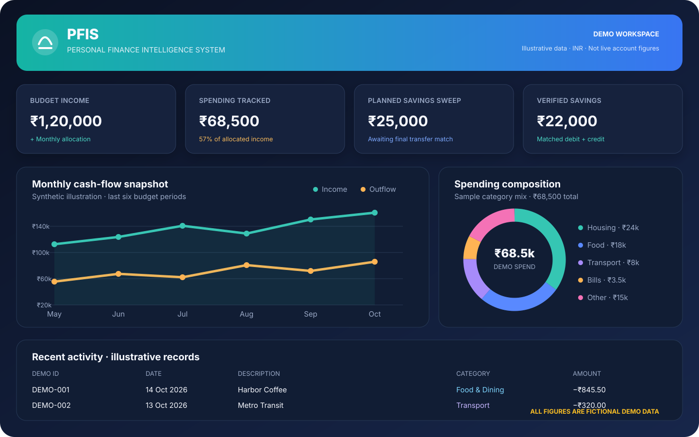
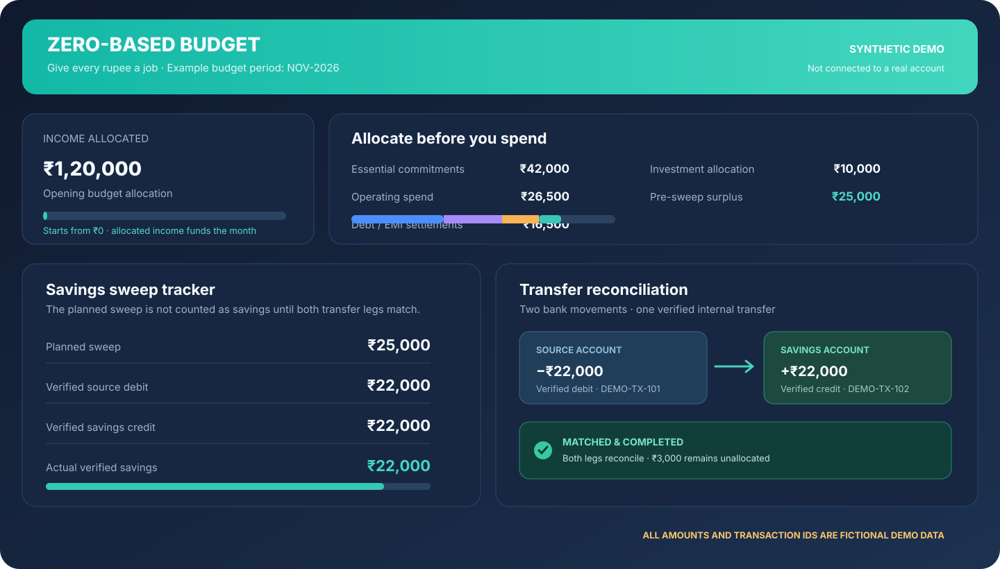
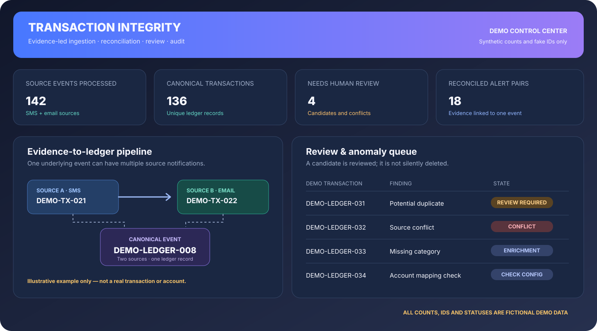
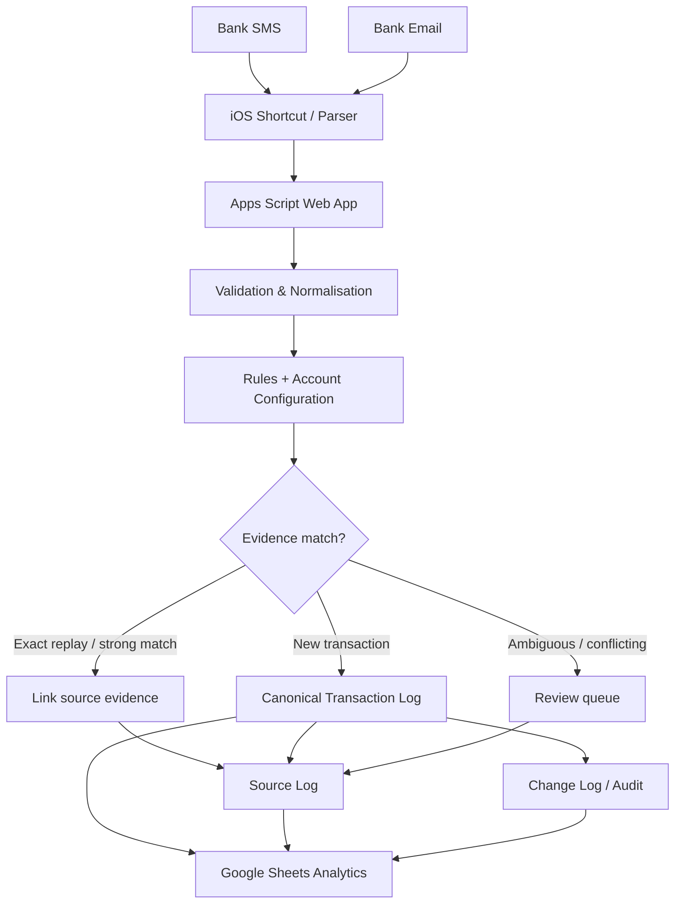

<div align="center">

# ✨ Personal Finance Intelligence System

### Capture clearly. Reconcile confidently. Understand your money.

**A privacy-conscious personal finance workflow built with Google Apps Script, Google Sheets and evidence-led transaction processing.**

<p>
  
  
  
  
</p>

<sub>All values, names, transaction IDs, charts and dashboard figures shown in this README are fictional examples. They are not copied from any live workbook, bank account or personal financial record.</sub>

</div>

---

## 📊 See the experience

The visuals below are **illustrative product mockups** made specifically for this README. They show the type of financial insights and controls the PFIS workbook is designed to present. They are not live screenshots or a claim that every visual component is automatically maintained by the Apps Script engine.

<p align="center">
  
</p>

<p align="center">
  
</p>

<p align="center">
  
</p>

> **Demo-data guarantee:** Every displayed figure is invented for demonstration. No actual transaction amount, account balance, merchant, card detail, transaction ID or personal record from the production spreadsheet is reproduced here.

## 🧭 What is PFIS?

The **Personal Finance Intelligence System (PFIS)** is a personal-finance workflow that turns bank notifications into a structured, auditable transaction ledger.

It is designed around a simple principle:

**A transaction should be traceable to its evidence, classified with care, and explainable later.**

PFIS receives bank SMS and email alerts, validates parser output, preserves original source evidence, resolves rules and account mappings, reconciles matching notifications, and records changes in an audit history. The accompanying Google Sheets workbook provides the financial summaries, dashboards, review views and planning tools.

### What it is designed to do

| Capability | What it provides |
|---|---|
| 📥 **Transaction capture** | Accepts structured SMS/email parser output through an Apps Script Web App |
| 🧾 **Canonical ledger** | Maintains one structured Transaction Log |
| 🔎 **Evidence preservation** | Retains source messages, IDs, hashes and processing outcomes |
| 🔁 **Duplicate protection** | Handles exact source replays and high-confidence transaction matches |
| 🧩 **Rule-based classification** | Applies merchant, amount and combined rules |
| 🏦 **Account resolution** | Uses bank/account/card configuration and available identifiers |
| 🧑‍⚖️ **Review controls** | Keeps conflicts and uncertain matches reviewable |
| 📝 **Audit history** | Records supported changes in an append-only Change Log |
| 📈 **Financial analytics** | Supports cash-flow, category, merchant, recurring and data-quality analysis |
| 💰 **Budget planning** | Separates the month income is received from the month it is allocated to |

## 🏗️ How the system fits together



The transaction engine is responsible for deterministic ingestion, reconciliation, validation and audit behaviour. Dashboard formulas, reporting layouts, charts and other workbook presentation layers are maintained separately and must be validated independently.

## 🗂️ Workbook architecture

The Apps Script engine requires six core sheets:

| Sheet | Responsibility |
|---|---|
| `Transaction Log` | Canonical transaction ledger; one row per accepted transaction |
| `Source Log` | Original SMS/email evidence, hashes, parse status and transaction links |
| `Change Log` | Detailed audit history for supported system and user changes |
| `Rules` | Transaction classification, purpose triggers and budget allocation rules |
| `Config` | Bank, account, card, instrument and internal-transfer mappings |
| `Categories` | Active categories used for validation and fallback classification |

The workbook may also contain supporting sheets such as `Recent Transactions`, `Monthly Summary`, `Dashboard`, `Dashboard_Calc`, `Insights & Data Quality`, `Reports`, `Data Dictionary`, `PFIS System Guide`, `Card Reconciliation Log`, `Rejected & Archive Log`, `Holiday Calendar` and `Savings Sweep Log`.

These supporting tabs are workbook/reporting layers; the engine does not generate all their formulas, visuals or planning workflows.

### Schema compatibility

- The canonical Transaction Log schema occupies **A:AC**.
- Legacy auxiliary fields occupy **AD:AM** when their documented headers are present.
- Optional reporting periods are stored in **AN: Budget Month** and **AO: Income Month** when those headers exist.
- The Rules core schema is **A:M**.
- Optional rule extensions include **N:S**, **T: Auto Purpose**, **U: Purpose Trigger**, **V: Calendar Scope**, and **W: Budget Month Offset**.
- Config's core fields are **A:I**; `Text Pattern` is an optional J-column extension.
- The optional `Holiday Calendar` uses the headers `Date`, `Calendar Scope`, `Is Working Day`, and `Description`.

**Do not reorder the core columns or rename required headers without updating and validating the engine.** The engine reads the canonical fields by established physical positions; optional period fields are located by header name.

## 🔄 Ingestion contract

All write operations use **HTTP POST with a JSON body**. A typical synthetic request looks like this:

```json
{
  "action": "ingest",
  "sourceType": "SMS",
  "txnString": "14/10/2026 09:15:00|-845.50|Demo Bank|Savings Account|UPI|expense|Harbor Coffee|Harbor Coffee|DEMO-UTR-1001|NA",
  "originalText": "DEMO ALERT: INR 845.50 debited at Harbor Coffee on 14/10/2026 at 09:15. Reference DEMO-UTR-1001."
}
```

For email, set `"sourceType": "EMAIL"` and pass `sender` and `subject` when available. Do not URL-encode the raw body before sending JSON. Do not omit `txnString`.

The `txnString` has ten logical pipe-delimited fields:

| Position | Field | Meaning |
|---:|---|---|
| 1 | `datetime` | Transaction date/time; date-only values retain lower precision |
| 2 | `signed_amount` | Outflows negative; inflows positive |
| 3 | `bank` | Bank/provider name |
| 4 | `account_type` | Savings, current, credit card, wallet, etc.; may be blank if unknown |
| 5 | `instrument` | Source-provided payment instrument |
| 6 | `type` | `expense`, `income`, `card_payment`, `investment`, `transfer` or `refund` |
| 7 | `merchant_name` | Merchant or transaction description |
| 8 | `counterparty` | Recipient, sender or counterparty |
| 9 | `ref_no` | UTR/reference when available |
| 10 | `balance_after` | Actual post-transaction account balance, if supplied |

For backwards compatibility, the parser accepts one known formatting defect: an extra leading empty pipe field. It does not guess how to repair missing or shifted middle fields. Placeholder values such as `NA` / `N/A` in optional fields are normalized to blank.

A successful HTTP response does not necessarily mean a new ledger row was inserted. Always inspect `status`, `transactionId`, `sourceId` and `requestId`.

## 🛡️ Evidence, replay and duplicate policy

PFIS distinguishes between a repeated source message, a second notification about the same event, and a transaction that merely looks similar.

| Situation | Expected behaviour |
|---|---|
| Exact source replay | Return the existing result; do not insert another canonical transaction |
| Strong SMS/email match | Link the second source to the existing canonical transaction |
| Generic merchant alert | Use supporting bank, amount, account and time evidence; do not rely on a generic merchant name alone |
| Card-payment confirmation | Reconcile eligible wallet/payment-rail and issuer notifications as one payment event when issuer, amount, date and identity evidence agree |
| Similar same-channel alert | Keep as a review candidate when the match is uncertain |
| Conflicting amount, reference or account identity | Preserve the conflict for review; do not silently merge |
| Confirmed duplicate | Archive only after an explicit human decision |

A date-only value is not proof of an exact time match. A timestamp, amount or shared reference alone is not sufficient to justify destructive merging.

### Human resolution

The `resolveexception` action supports:

- `CONFIRM_DISTINCT` — retain the transaction after human confirmation.
- `CONFIRM_DUPLICATE` — archive a confirmed duplicate using `duplicateOf` to identify the surviving canonical transaction.

A specific reason is required. The confirmed-duplicate path preserves the archived transaction, re-links associated source evidence to the survivor, and records audit history. Historical transactions are not automatically deleted or merged by new duplicate-prevention logic.

## 🧠 Rules, purpose and salary allocation

Rules support these match types:

- `MERCHANT`
- `AMOUNT`
- `AMOUNT+MERCHANT`

More-specific rules should win. Lower numeric priority breaks ties where the evidence is otherwise safe. Equally ranked rules that disagree remain ambiguous rather than being guessed.

### Purpose is optional

A blank Purpose / User Notes value is valid. It does not block ingestion, approval, normal reporting or the required enrichment queue.

- A meaningful configured purpose may be written when `Auto Purpose=TRUE`.
- A rule may also use an explicitly configured `Purpose Trigger`.
- Recurrence alone is not permission to invent the purpose of a transaction.
- Missing Purpose can still be measured as a data-quality attribute.
- If a category is blank or unmapped, the engine uses the active `Miscellaneous` category when available.

### Separate earned month from budget month

Salary descriptions and budget allocation use separate offsets:

| Rule field | What it controls |
|---|---|
| `Month Offset` (H) | Month label in the configured Notes Template |
| `Purpose Trigger` (U) | Condition for triggering rule-generated purpose |
| `Calendar Scope` (V) | Working-day calendar to evaluate |
| `Budget Month Offset` (W) | Budget period assigned to the transaction |

For a month-end salary example:

- `Month Offset=0` keeps the salary purpose tied to the transaction's actual month.
- `Purpose Trigger=LAST_WORKING_DAY_OF_MONTH` checks the transaction date.
- `Budget Month Offset=1` assigns that income to the next budget month.

The working-day helper treats Monday–Friday as working by default. Optional `Holiday Calendar` rows can override a date for a named scope such as `HCL` or for `ALL`. Only verified holiday/working-day values should be entered.

The engine populates optional `Income Month` for income transactions and `Budget Month` for transactions when those headers exist. It does not create a forecast salary transaction.

## 💸 Budgeting and savings sweep concepts

The workbook's budget model separates actual cash flow from budget allocation:

- **Actual cash flow** is based on the real transaction date.
- **Income Month** is the month income is received.
- **Budget Month** is the period the income is allocated to.
- **Planned savings sweep** is an intention, not yet actual savings.
- **Actual verified savings** requires a reconciled transfer from the source account to the destination savings account.

A sweep should be treated as completed only when both the source debit and destination credit have been identified and reconciled. Internal transfers must not be counted as consumption expenses or fresh income.

The dashboard visual above is a fictional example of how the distinction can be presented. **The Apps Script does not initiate bank transfers or move money.** The `Savings Sweep Log` and associated budget formulas are workbook-side planning/reconciliation features and must be configured and validated separately.

## 📈 Analytics and data quality

The engine exposes structured read operations that a dashboard or other client can use:

| Action | Purpose |
|---|---|
| `health` / `ping` | Runtime and version health |
| `validate` / `validateschema` | Workbook schema validation |
| `gettransaction` / `gettransactiondetail` | Read a transaction |
| `getpendingreview` | Pending transaction/source-conflict review items |
| `getneedsenrichment` | Transactions requiring category classification |
| `searchtransactions` | Search and filter the canonical ledger |
| `getfinancialoverview` | Summary-level financial metrics |
| `getcategorybreakdown` | Category analysis |
| `getmerchantanalysis` | Merchant analysis |
| `getrecurringcommitments` | Recurring commitments |
| `getcashflow` | Cash-flow analysis |
| `getspendingbehavior` | Spending behaviour metrics |
| `getanomalies` | Anomaly candidates |
| `getdataquality` | Data-quality counts and evidence status |

The `getdataquality` response nests its metrics under `response.data`. Examples include:

- `needsReview`
- `duplicateCandidates`
- `sourceConflicts`
- `missingMerchant`
- `missingCategory`
- `missingPurpose`
- `unknownType`
- `dateOnly`
- `suspectedInventedMidnightTimestamps`
- `verified`, `smsOnly` and `emailOnly`

**Missing Purpose is separate from Needs Review.** A transaction may have no Purpose and still be valid. Duplicate candidates, source conflicts, invalid transaction types and other integrity problems remain reviewable.

The engine returns analytics data; the workbook is responsible for presenting it. Formula ranges, helper tabs, chart sources and dashboard refresh behaviour should be validated independently.

## ⚙️ Config and account/card resolution

The required Config fields A:I are:

`Bank`, `Account Type`, `Account/Card Suffix`, `Merchant Contains`, `Account`, `Card Name`, `Instrument`, `Is Internal`, `Priority`.

An optional J-column `Text Pattern` can provide additional identity evidence when supported by the workbook configuration.

- Higher specificity should win; priority may break a safe tie.
- A suffix-specific rule must not match when the source does not identify the configured suffix.
- Source instrument takes precedence over rule override, which takes precedence over Config default.
- Do not guess between different cards when the alert does not identify which card was used.
- Mark `Is Internal` only for accounts genuinely owned by the user and only after testing how the reporting layer treats internal transfers.

## 🧪 Testing and release checklist

Before production ingestion or deployment:

1. Run schema/config validation against the intended staging spreadsheet.
2. Run `PFIS_RUN_ALL_PREFLIGHT_TESTS()` from the Apps Script editor.
3. Confirm the synthetic test report and cleanup status.
4. Test one representative SMS ingestion.
5. Test its corresponding email, including a delayed email with a matching reference.
6. Replay an identical source and confirm no second canonical transaction is inserted.
7. Test a same-channel likely duplicate and confirm uncertain cases remain reviewable.
8. Test a conflicting amount/reference/account and confirm it is preserved for review.
9. Test a generic merchant notification and an eligible card-payment confirmation pair.
10. Test a last-working-day purpose trigger, including a configured holiday override.
11. Test blank Purpose and blank Category handling.
12. Test a confirmed duplicate archive and verify source re-linking and Change Log entries.
13. Check Transaction Log, Source Log and Change Log IDs, links and row placement.
14. Validate workbook formulas, monthly summaries and dashboards separately.
15. Deploy a new Web App version when applicable, then perform a controlled production smoke test.

Local/mocked logic checks are not equivalent to running the complete test harness against Google Sheets and Apps Script services. Do not describe the system as production-certified until the actual staging run passes.

## 🚀 Setup and deployment

### Required Script Property

- `SPREADSHEET_ID` — the Google Spreadsheet ID, taken from the URL between `/d/` and `/edit`.

### Optional Script Property

- `WEB_APP_SECRET` — when configured, requests must include the expected token in the JSON body.

### Deployment notes

1. Open the Apps Script project connected to the intended staging workbook.
2. Add the transaction engine file and preflight test file to the same project.
3. Configure script properties and verify the spreadsheet timezone/reporting setup.
4. Run schema validation and the preflight suite.
5. Inspect the execution report and test the end-to-end ingestion paths.
6. Deploy a new Web App version when the deployed endpoint must use updated code.
7. Promote to production only after staging is clean.

Keep staging and production spreadsheets separate. Do not point destructive or synthetic test runs at a production ledger.

## ⚡ Reliability and performance principles

- Use POST JSON for write operations; never use GET for ingestion or updates.
- Serialize writes with `LockService` to protect transaction IDs, duplicate checks and row allocation.
- Allocate rows using logical key-column and full-row safety checks; a blank ID alone does not make a row reusable.
- Cache Rules, Config, Categories, source and transaction reads within a request.
- Preserve source evidence and detailed audit history.
- Make retries idempotent wherever the source identity is known.
- Do not let diagnostic logging mask the original processing error.
- Do not clear Source Log or Change Log as routine cleanup.

## 📚 Project files

| File | Purpose |
|---|---|
| `PFIS_TransactionEngine_v1.0.0.gs` | Production Apps Script transaction engine |
| `PFIS_Preflight_Tests_v1.0.0.gs` | Bounded synthetic regression/preflight harness |
| `PFIS_Shortcut_Implementation_v1.0.0.txt` | iOS Shortcut implementation reference |
| `PFIS_Prompts_Final_v1.0.0_Prompts.txt` | Prompt/reference material |
| `REVIEW_NOTES.md` | Engineering review notes |
| `docs/images/` | Synthetic README dashboard illustrations |

## 🔐 Privacy and example-data policy

This repository's README visuals and payload examples use fictional names, figures, identifiers and dates. They are not screenshots of the live financial workbook.

Do not commit:
- Real bank SMS/email contents
- Account or card numbers
- Personal transaction IDs
- Real balances or financial statements
- Secrets, access tokens or spreadsheet IDs

Use synthetic fixtures for screenshots, documentation, examples and tests.

---

<div align="center">

### Built for clarity, traceability and better financial decisions.

**PFIS · Personal Finance Intelligence System · v1.0.0**

<sub>Google Apps Script · Google Sheets · Evidence-led transaction intelligence</sub>

</div>
