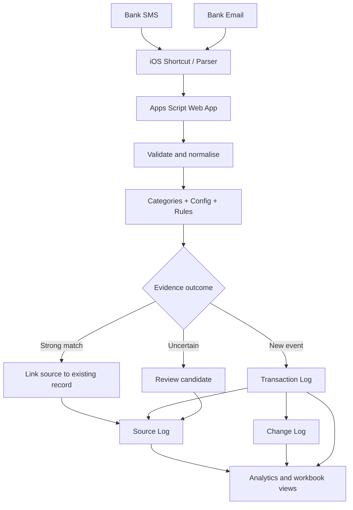

# PFIS · Personal Finance Intelligence System

### From a bank alert to a financial story you can understand.

**Capture → Reconcile → Classify → Analyse → Plan**

A personal finance workflow that turns scattered bank notifications into a traceable ledger, meaningful financial analytics and a clearer monthly plan.

[Explore the story](#one-transaction-a-complete-journey) · [Understand configuration](#configuration-the-four-layers-that-make-pfis-work) · [Explore analytics](#the-analytics-what-each-view-helps-you-understand) · [See the engine](#under-the-hood)

**Version 1.0.0** · Google Apps Script · Google Sheets

Illustrations use invented values and identifiers. No live workbook figures, bank details or personal transactions are displayed.

---

## The idea in one view

PFIS is built around a simple question:

**Can a financial record explain where it came from, what it means, how it was checked and how it affects the monthly plan?**

Instead of treating every SMS or email as a separate transaction, PFIS preserves the original notification, interprets it using configuration, checks whether it describes an existing event, and either links it to the canonical record, creates a new record or keeps the uncertainty visible for review.

  

The configuration model — four layers, each with a distinct responsibility · Fictional demonstration values only.

## One transaction, a complete journey

Imagine a fictional bank notification:

> **DEMO BANK:** INR 845.50 debited at Harbor Coffee. Reference DEMO-UTR-1001.

Here is what PFIS does with it.

| Stage | What happens | Why it matters |
|---|---|---|
| **1 · Capture** | An iOS Shortcut passes the SMS/email content to the Apps Script Web App. | The original alert is retained as evidence. |
| **2 · Interpret** | The parser extracts date, signed amount, bank, account type, merchant, transaction type and reference. | Raw notification text becomes structured information. |
| **3 · Configure** | Categories, Config and Rules resolve the category, account and any trusted purpose template. | Classification is consistent rather than dependent on ad-hoc guesses. |
| **4 · Reconcile** | PFIS checks source replay, matching SMS/email evidence and possible payment-event relationships. | Two alerts about one event need not become two expenses. |
| **5 · Record** | A new canonical transaction is written, or evidence is linked to an existing one. Uncertain cases stay reviewable. | The ledger remains explainable and auditable. |
| **6 · Understand** | The transaction contributes to cash-flow, category, merchant and data-quality analysis. | A single event becomes part of a broader financial picture. |

A simplified example of the resulting record:

| Transaction ID | Date | Merchant | Amount | Category | Source coverage |
|---|---|---|---:|---|---|
| DEMO-TX-001 | 14 Oct 2026 | Harbor Coffee | −₹845.50 | Food & Dining | SMS + Email |

DEMO-TX-001 and all sample values above are invented for documentation.

### What happens when another alert arrives?

- If the same source is replayed, PFIS recognises the replay and does not insert another canonical transaction.
- If a matching email describes the same bank event, PFIS can link the second source to the existing transaction.
- If a wallet and card issuer each confirm the same eligible card-payment event, their evidence can be associated with one payment event when issuer, amount, date and identity checks agree.
- If two transactions merely look similar, or their account/reference evidence conflicts, PFIS keeps the case for review rather than silently merging it.

This is the central design choice: **preserve evidence first; automate only when the match is sufficiently strong.**

---

## Configuration: the four layers that make PFIS work

A new user does not need to configure every transaction individually. PFIS uses four small configuration layers to make repeated decisions consistently.

### 1. Categories — define the language of your finances

The Categories sheet is the approved vocabulary for classifying transactions.

Examples:

| Category | Typical use |
|---|---|
| Income | Salary and other genuine inflows |
| Housing & Utilities | Rent, electricity and household bills |
| Food & Dining | Groceries, restaurants and cafes |
| Transport | Fuel, public transport and travel |
| Shopping | Retail and personal purchases |
| Investments | SIPs and investment contributions |
| Debt Service | Loan and debt obligations |
| Miscellaneous | Safe fallback when no category can be resolved |

Keep categories mutually understandable and avoid creating multiple labels for the same kind of activity. The engine validates against active categories and uses **Miscellaneous** as the fallback when it is active and a category is missing or unmapped.

### 2. Config — identify the account behind the alert

Config answers: **Which bank account or card generated this notification?**

The core fields are:

| Field | What to enter |
|---|---|
| Bank | Normalised bank/provider name |
| Account Type | Savings, current, credit card, wallet, etc. |
| Account/Card Suffix | Only the identifying suffix available in the alert |
| Merchant Contains | Optional evidence used when the notification is merchant-specific |
| Account | A friendly internal account label |
| Card Name | A friendly card label, where relevant |
| Instrument | UPI, card, net banking, etc. |
| Is Internal | TRUE only for transfers between accounts genuinely owned by the user |
| Priority | Tie-breaker after evidence specificity |
| Text Pattern (optional J) | Additional text evidence, when needed |

Use friendly labels such as `MAIN_SAVINGS` or `TRAVEL_CARD`. Never store full account/card numbers in documentation or examples. A priority value must not be used to guess which card was charged when the source does not identify it.

### 3. Rules — teach PFIS how to classify repeated patterns

Rules answer: **When this evidence appears, what should PFIS do?**

Supported match types:

| Match type | When to use it |
|---|---|
| `MERCHANT` | A stable merchant or sender pattern identifies the activity. |
| `AMOUNT` | A distinctive amount is useful, but should be combined with safe merchant evidence where possible. |
| `AMOUNT+MERCHANT` | Both amount and merchant pattern must agree. |

A rule can set the category, merchant override, notes template, recurring flag, type, account/card overrides and priority. More-specific rules should win; equally ranked rules that disagree remain ambiguous.

The established Rules layout is:

| Columns | Purpose |
|---|---|
| A:M | Core match and classification fields |
| N:S | Optional rule metadata and confidence fields |
| T · Auto Purpose | Allows a meaningful configured purpose to be written when explicitly TRUE |
| U · Purpose Trigger | Conditional purpose trigger |
| V · Calendar Scope | Calendar used by a working-day trigger |
| W · Budget Month Offset | Month to which the transaction is allocated |

**Purpose is optional.** A blank Purpose/User Notes value does not block transaction capture or approval. A configured purpose can be written by `Auto Purpose=TRUE`, or by a supported rule trigger. Recurrence by itself is not permission to invent a transaction's purpose.

### 4. Holiday Calendar — make working-day rules explicit

The optional Holiday Calendar has four headers:

`Date` · `Calendar Scope` · `Is Working Day` · `Description`

The engine treats Monday–Friday as working days by default and Saturday/Sunday as non-working days. A verified scoped override can change that assumption for a company calendar such as HCL; `ALL` can be used for a general override.

Only enter verified holidays or exceptional working days. The calendar must reflect the employer's actual practice, not a guessed public-holiday list.

### Example: salary received at month end

A salary received on the last working day of October is October income, even when it is intended to fund November.

| HCL rule setting | Example value |
|---|---|
| Match Type | MERCHANT |
| Merchant Contains | HCL |
| Category | Income |
| Merchant Override | HCLTech |
| Notes Template | Salary from HCL for {{monthLabel}} |
| Month Offset (H) | 0 |
| Is Recurring | TRUE |
| Type Override | income |
| Auto Purpose (T) | FALSE |
| Purpose Trigger (U) | LAST_WORKING_DAY_OF_MONTH |
| Calendar Scope (V) | HCL |
| Budget Month Offset (W) | 1 |

The result is deliberately split:

| Concept | October salary example |
|---|---|
| Transaction Date | 30-Oct-2026 |
| Purpose | Salary from HCL for Oct-26 |
| Income Month | Oct-26 |
| Budget Month | Nov-26 |

**Month Offset and Budget Month Offset are not the same setting.** The first controls the month label in the purpose template. The second controls the budget period.

---

## The analytics: what each view helps you understand

PFIS analytics are not just attractive charts. Each view should answer a different financial question. The dashboards below are illustrative product mockups using fictional data; they demonstrate analytical layouts, not live workbook results.

### 1. Is income keeping pace with spending?

This view compares incoming money with operating outflows, shows net cash movement and highlights savings rate over time.

  

Four complementary views: income versus outflow, budget allocation, net cash movement and savings rate · Fictional demonstration values only.

**Questions it helps answer:** Is spending rising faster than income? Is the monthly surplus improving? How much of allocated income is retained?

### 2. Where does the money go?

Category analysis shows the largest spending groups. Merchant concentration identifies repeated high-value destinations. Timing analysis shows when outflows occur, while recurring trends separate predictable commitments from variable spending.

  

Category mix, leading merchants, weekday activity and recurring commitments · Fictional demonstration values only.

**Questions it helps answer:** Which categories dominate? Which merchants account for repeated outflows? Are commitments becoming heavier? Do spending patterns change by weekday?

### 3. Is the data trustworthy enough to act on?

This view separates source notifications from unique transactions, shows how evidence is reconciled and makes unresolved cases visible. Missing Purpose is measured separately because it is optional; it is not treated as a mandatory review defect.

  

Evidence funnel, SMS/email coverage, review composition and data-quality signals · Fictional demonstration values only.

**Questions it helps answer:** How many alerts became canonical records? How much evidence is cross-verified? What needs human attention? Are missing descriptions being confused with financial integrity problems?

### 4. Did the planned savings actually reach savings?

Zero-based budgeting gives the month's allocated income a job. A planned sweep is not actual savings until the debit from the source account and credit to the savings account are both verified and reconciled.

  

Budget allocation, planned sweep and verified two-leg transfer reconciliation · Fictional demonstration values only.

**Questions it helps answer:** How much was planned for savings? What was actually transferred? Is a sweep still pending or does it reconcile? What remains unallocated?

The Apps Script does not initiate bank transfers. The budget and Savings Sweep Log are workbook-side planning and reconciliation concepts; they must be configured in the spreadsheet.

### Analytics available from the engine

| Analysis | What it measures |
|---|---|
| Financial overview | Income, expenses, refunds, investments, card payments, transfers and net cash flow |
| Category breakdown | Gross expenses, refunds, net consumption and transaction count by category |
| Merchant analysis | Gross spend, refunds, net consumption and transaction count by merchant |
| Recurring commitments | Transactions marked recurring and an estimated annualised amount |
| Cash flow | Income, outflows, refunds, internal transfers excluded and net cash flow |
| Spending behaviour | Expense count and gross spend by weekday |
| Anomalies | Duplicate candidates, source conflicts, unusually high expenses and collision candidates |
| Data quality | Review count, evidence verification, missing merchant/category/purpose, date precision and source coverage |

Cash-flow and consumption are intentionally different views. Card payments can be cash outflows while the underlying card purchases are the consumption events. Internal transfers are excluded from net cash flow when correctly configured. Do not add both a card purchase and its bill settlement as two consumption expenses.

---

## What makes PFIS different

| Design choice | Why it matters |
|---|---|
| **Evidence before inference** | Original alerts are retained so a ledger record can be traced back to its source. |
| **One canonical ledger** | SMS and email are evidence channels, not separate financial books. |
| **Conservative reconciliation** | Strong matches are linked; ambiguous matches remain visible for review. |
| **Optional purpose** | An unavailable description does not stop a valid transaction from being recorded. |
| **Working-day-aware salary rules** | Salary purpose can reflect the earned month while budget allocation funds the following month. |
| **Separate cash flow and consumption** | Transfers and card settlements are not automatically treated as everyday spending. |
| **Auditable corrections** | Supported updates and confirmed duplicate decisions leave a history. |
| **Honest data quality** | Missing optional descriptions, date-only evidence and genuine integrity exceptions are measured separately. |

The objective is not to automate every judgement. It is to automate repeatable work while preserving uncertainty where a financial decision would otherwise be guessed.

---

## Under the hood

The production engine is a Google Apps Script Web App. iOS Shortcuts is the source collection/enrichment client, Google Sheets stores the canonical records and configuration, and the engine provides ingestion, reconciliation, read operations and controlled updates.

### System flow

### Core workbook records

| Sheet | Role |
|---|---|
| Transaction Log | Canonical financial records; core schema A:AC |
| Source Log | Original SMS/email evidence, parsing outcomes, hashes and links |
| Change Log | Detailed audit history |
| Rules | Classification and purpose/budget rules |
| Config | Bank/account/card/instrument resolution |
| Categories | Active classification vocabulary |

Additional views such as Recent Transactions, Monthly Summary, Dashboard, Dashboard_Calc, Insights & Data Quality, Reports, Data Dictionary, PFIS System Guide, Card Reconciliation Log, Rejected & Archive Log, Holiday Calendar and Savings Sweep Log belong to the wider workbook/reporting layer.

### API actions

All write operations use HTTP POST with JSON. The main read actions are:

`health`, `validate`, `gettransaction`, `getpendingreview`, `getneedsenrichment`, `searchtransactions`, `getfinancialoverview`, `getcategorybreakdown`, `getmerchantanalysis`, `getrecurringcommitments`, `getcashflow`, `getspendingbehavior`, `getanomalies`, `getdataquality`.

The `getdataquality` metrics are nested under `response.data`. Its `missingPurpose` metric is separate from `needsReview`.

The write actions include `ingest`, `update`, `reprocesssource` and `resolveexception`. Duplicate resolution supports `CONFIRM_DISTINCT` or `CONFIRM_DUPLICATE` with a surviving `duplicateOf` ID and a human reason.

### Source files and implementation references

- [Production Transaction Engine](https://github.com/asish312/Personal-Finance-Intelligence-System/blob/main/PFIS_TransactionEngine_v1.0.0.gs)
- [Preflight regression harness](https://github.com/asish312/Personal-Finance-Intelligence-System/blob/main/PFIS_Preflight_Tests_v1.0.0.gs)
- [iOS Shortcut implementation reference](https://github.com/asish312/Personal-Finance-Intelligence-System/blob/main/PFIS_Shortcut_Implementation_v1.0.0.txt)
- [Prompt reference](https://github.com/asish312/Personal-Finance-Intelligence-System/blob/main/PFIS_Prompts_Final_v1.0.0_Prompts.txt)
- [Engineering review notes](https://github.com/asish312/Personal-Finance-Intelligence-System/blob/main/REVIEW_NOTES.md)
- [All README illustrations](https://github.com/asish312/Personal-Finance-Intelligence-System/tree/main/docs/images)

### Technical contract

The ten-field `txnString` is:

`datetime | signed_amount | bank | account_type | instrument | type | merchant_name | counterparty | ref_no | balance_after`

Expenses/outflows are negative; income/inflows are positive. Date-only evidence retains lower precision. The engine uses `Asia/Kolkata` for transaction-date and period logic. A supplied balance must be an actual post-transaction account balance, never a credit limit or available balance.

The required Script Property is `SPREADSHEET_ID`. `WEB_APP_SECRET` is optional; when configured, requests must carry the matching token as required by the endpoint.

### Version and responsibility boundaries

**PFIS production engine: v1.0.0** · Google Apps Script + Google Sheets.

The engine owns deterministic transaction processing and its supported API contracts. The workbook owns dashboard formulas, reporting presentation, budget planning and savings-sweep reconciliation. iOS Shortcuts owns source capture and any client-side enrichment. A visual mockup in this README is not proof that a corresponding live chart or workbook workflow has already been deployed.

---

### A clearer financial picture, built from explainable records.

**Capture the event. Preserve the evidence. Understand the pattern.**

PFIS · Personal Finance Intelligence System · v1.0.0

